# Life Atlas 1.6.0 用户手册

> 本手册适用于 Life Atlas 1.6.0 Windows 版。配图来自 1.0.0 测试版的实际窗口，覆盖 11 个画面的白天和夜间模式，共 22 张。具体控件以当前界面为准。

Life Atlas 是本地优先的个人知识工作区。页面、数据库、附件和密钥库保存在你选择的数据目录里。日常编辑和识图可离线使用。需要 AI 时，可以连接自己选择的本机或云端模型服务。

最重要的三件事：选择可靠的数据目录；把完整备份存到另一块硬盘或 U 盘；把密钥库恢复密钥离线保管。

## 1. 安装与第一次打开

1. 双击下载的 Life Atlas 1.6.0 安装程序，按中文向导安装。可以选择程序的安装位置。
2. 第一次打开时，选择**数据目录**。这是保存全部页面、附件、密钥库和快照的地方，与程序安装位置不是一回事。
3. 建议使用独立的本地目录，例如 `D:\LifeAtlas`。不要放在 OneDrive、其他同步盘或程序安装目录里；同步软件同时改动文件可能损坏数据。
4. 第一次使用，可选择“新建空白工作区”；已经有 Life Atlas 数据目录时，选择原目录，再选“打开这个工作区”即可继续使用。不要为了重新安装而新建一份空目录覆盖原数据。

记住这个目录的位置。以后可以在“设置 → 数据”中查看或打开它。

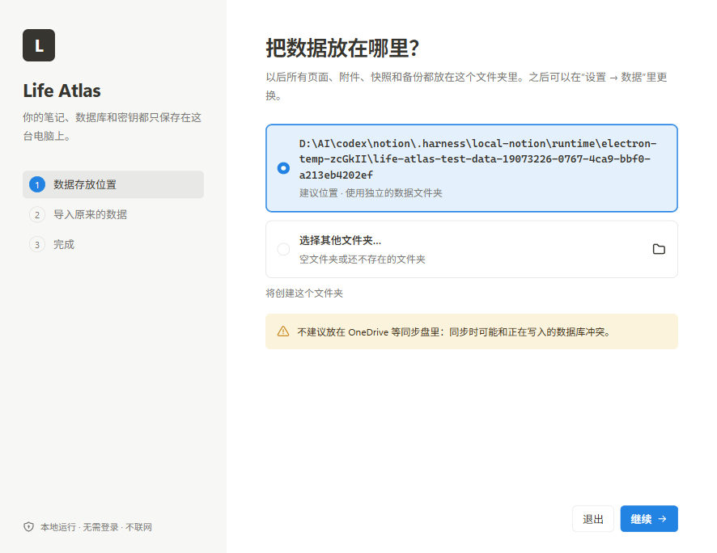

### 从旧版更新

在旧版的「设置 → 数据」确认原数据目录，导出并校验一份完整备份。关闭旧版后运行新版。若首次启动向导出现，选回原数据目录，再选择「打开这个工作区」。兼容性测试已用 UI40、APEX 和 1.1.0 市集测试包的合成样本打开原 SQLite 工作区、页面、数据库、附件和密钥库，并检验了历史 `.lifeatlas` 备份恢复。[兼容性测试范围](../tests/fixtures/compatibility/README.md)

## 2. 从浏览器版搬到桌面版

1. 由你在浏览器中用**平时使用的地址**打开原来的 Life Atlas。不同地址可能对应不同的浏览器数据，请不要换地址试着迁移。
2. 在工作区菜单中打开“备份与恢复…”，导出一份完整备份，得到 `.lifeatlas` 文件。
3. 安装并第一次打开桌面版，选择本地数据目录，再选择“从备份恢复”。
4. 选择刚导出的文件，核对页面、数据库和附件等数量，再确认开始使用。
5. 打开几篇页面、查看数据库，并确认图片和附件可用。必要时重新导出一份桌面版完整备份。

**核对无误前，不要清理浏览器数据，也不要删除迁移备份。** 浏览器导出的备份是你的回退保障。若第一次启动向导已经完成，可从工作区菜单的“备份与恢复…”进入恢复流程；恢复会替换当前工作区，操作前先备份当前内容。

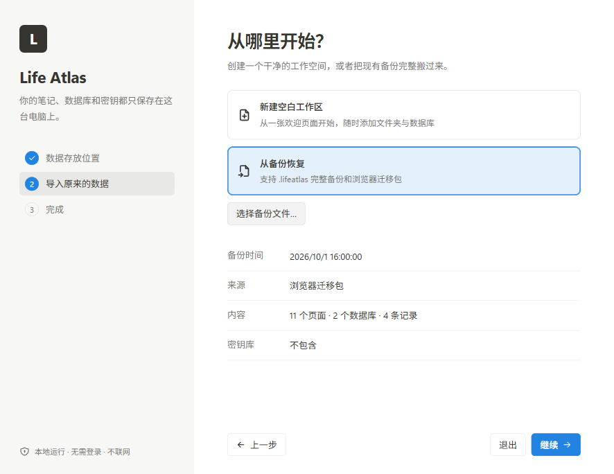

## 3. 日常备份

Life Atlas 会在数据目录里保留**每日、升级前、迁移前、恢复前**的自动快照。它们帮助你回到较早状态，但不等于独立备份：数据目录所在的硬盘损坏、丢失或被整体删除时，快照也可能一起消失。

建议每周，以及大批修改、搬家、重装或升级前：

1. 打开工作区菜单 → “备份与恢复…” → “完整备份”。
2. 若已使用密钥库，保留“包含密钥库”。应用会在独立的密钥库窗口里要求再次输入主密码确认。
3. 需要保护普通页面和附件时，勾选“加密整个备份”，设置**备份密码**并确认。备份密码与密钥库主密码是两把不同的钥匙，请分别保管。
4. 点击“导出”，把 `.lifeatlas` 文件存到**另一块硬盘或 U 盘**。不要只在原数据目录里留一份。
5. 在“校验备份”页选择文件，检查它有没有损坏。最好定期在另一份测试数据目录中练习恢复，不要拿唯一一份正在使用的数据试验。

密钥库在完整备份中始终保持加密；未选择整包加密时，**普通页面、数据库和附件不是密钥库那样的加密内容**。忘记整包备份密码，该加密备份就无法打开。

可以在“定期备份”页启用计划，选择另一块硬盘或外置存储、星期、时间和保留份数，再保存计划。定期备份在应用运行时执行；电脑关机或应用没运行时不会替你完成备份。偶尔查看上次结果，确认目标存储仍然连接、空间足够。

也可以将备份保存到 OneDrive 或 Google Drive 桌面客户端同步的本机文件夹。网盘客户端显示上传结果。换机时先把完整备份下载到本机，再在 Life Atlas 中校验并恢复。[网盘设置与费用](云盘备份.md)

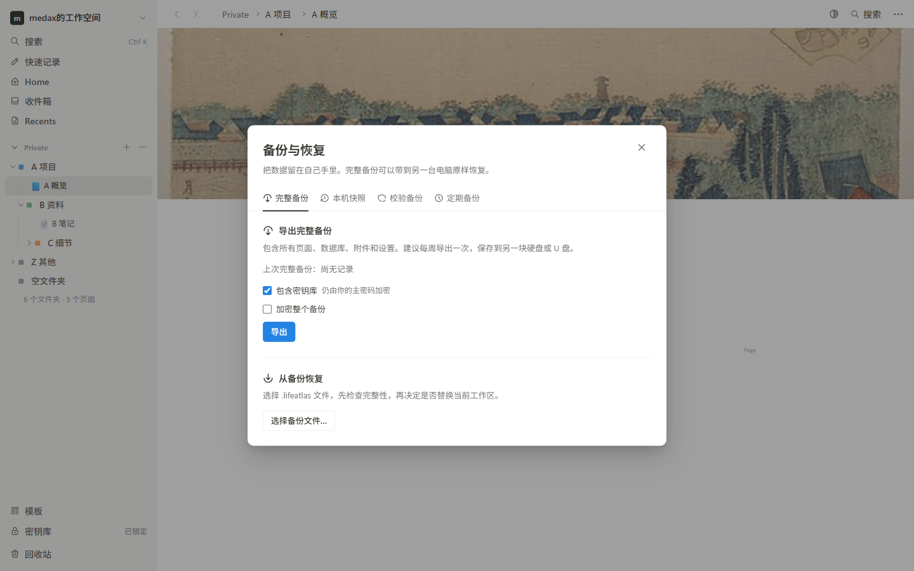

## 4. 在新电脑上恢复

1. 在旧电脑导出完整备份；需要密钥库时，确认已勾选“包含密钥库”。把文件带到新电脑。
2. 在新电脑安装 Life Atlas，第一次打开时选择一个合适的本地数据目录。
3. 选择“从备份恢复”，再选择 `.lifeatlas` 文件。
4. 如果备份加密了，输入**备份密码**。先核对摘要，再确认恢复。
5. 开始使用后，检查页面、数据库和附件。密钥库恢复后仍然上锁，用**导出那份备份时的原主密码**解锁；也可以用对应的恢复密钥找回。

备份密码只打开整包备份，不会替代密钥库主密码。较旧的备份或快照可能仍需当时的主密码／恢复密钥。新电脑上的现有工作区若要被替换，先导出它的完整备份。

从已验证的 UI40 和 APEX 历史样本恢复时，可以打开未加密和整包加密的 `.lifeatlas` 完整备份。恢复自己的备份时，使用创建该份备份时的口令。遇到无法识别的数据库或密钥库格式时，应用会保留原件，并提示你选择恢复方式。同一台电脑和同一 Windows 账户下，原有本机配置可继续使用由系统保管的 AI 服务密钥。迁到另一台电脑时，可以将 API Key 保存在密钥库，并通过勾选「包含密钥库」的完整备份带过去。

## 5. 密钥库

点击侧栏“密钥库”，敏感内容会在独立窗口中打开。账号、API Key、服务器密码等请放在这里，**不要放在普通页面或快速记录里**。

### 第一次设置

- 主密码至少 **12 个字符**，至少有 **5 种不同字符**。中文也可以使用。
- 不可使用常见密码，也不可只在常见密码前后加数字或符号。
- 不可使用简单的顺序／倒序字符，或把同一段字符反复重复。选择足够长、难以猜到且不在别处复用的口令。
- 输入两次主密码后，按界面提示保存恢复密钥，并输入最后两组确认。**打印恢复卡或抄在纸上，离线保管，不要只存在这台电脑里。**

主密码只应在密钥库窗口输入。工作区里的备份操作可以发起确认，但不会在普通页面中索要主密码；在其他地方遇到索要主密码的输入框，请停止操作。

### 日常使用与找回

- 上锁时输入主密码解锁。查看一条密钥后，可以按字段“显示”或“复制”；敏感字段默认隐藏。
- 打开条目编辑，在「备注附件」点「添加附件」，可以多选图片、PDF、文档及其他格式。文件随条目加密保存，包含密钥库的完整备份也会带上附件。单个文件最多 8 MiB，每条合计最多 16 MiB、32 个文件。在编辑或查看条目时，点附件旁的下载按钮，将解密后的原文件保存到自己选择的位置。
- 闲置达到设定时间、系统锁屏或睡眠时会自动上锁。离开电脑前，也可以主动点击“上锁”。
- 复制的内容会按设置自动从当前剪贴板清除；若你已复制了其他内容，不会误清除新内容。Windows 的 `Win+V` 剪贴板历史或其他剪贴板工具可能另存副本，请关闭这些记录功能，不要把自动清除当成彻底抹除所有历史。
- 忘记主密码时，在锁屏界面点击“忘记主密码？使用恢复密钥”，按提示设置新主密码，并离线保存**新的恢复密钥**。修改主密码或重新生成恢复密钥后，旧钥匙对当前密钥库失效。
- **主密码和恢复密钥都丢失，就无法打开原密钥库，没有后门。** “重置密钥库”只是重新开始，不会解开旧内容；旧密钥库会保留在快照中，将来找到对应钥匙才能恢复。

密钥库窗口启用了截图与录屏保护，Windows 上通常会在普通截图／录屏中显示为空白或黑色；它不能保证挡住所有远程桌面、录屏工具、摄像头、木马或内存读取。电脑感染木马时解锁过、或程序本身被恶意改写，软件无法替你保证安全。离线猜密码也不受应用内等待时间限制，因此强主密码和设备安全仍然重要。

若从浏览器的密码 CSV 导入条目，先核对导入结果，再**删除那份明文 CSV**，包括你额外复制到其他位置的副本。不要把明文 CSV 当作长期备份。

手册中的条目全部是虚构示例，字段值为“示例-不是真的”，不是可使用的账号或密钥。

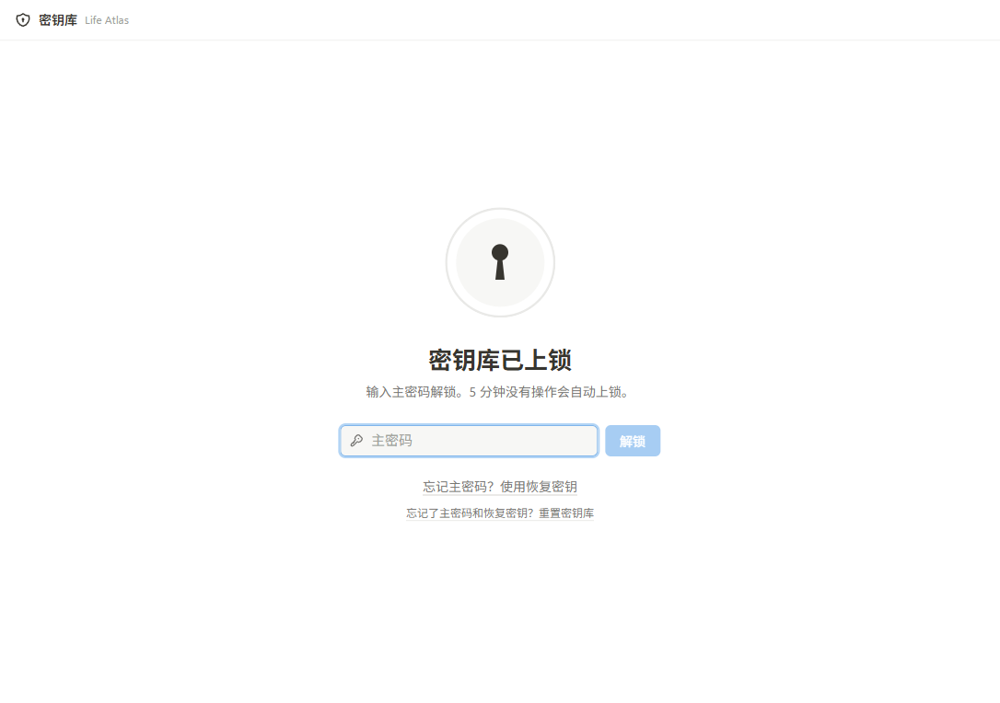

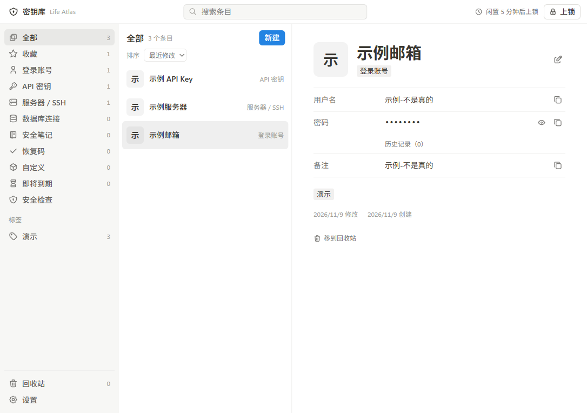

## 6. 模板、时间脉络与官方市集

### 软件开发进程模板

1. 点击侧栏“模板”，在模板库中选择“开发 → 软件开发进程”。
2. 输入项目名、选择放入的文件夹；初次体验可以保留“包含示例数据”。
3. 点击“使用模板”，生成项目页面、里程碑与阶段、任务等内容。示例可以编辑或删除，不影响其他项目。

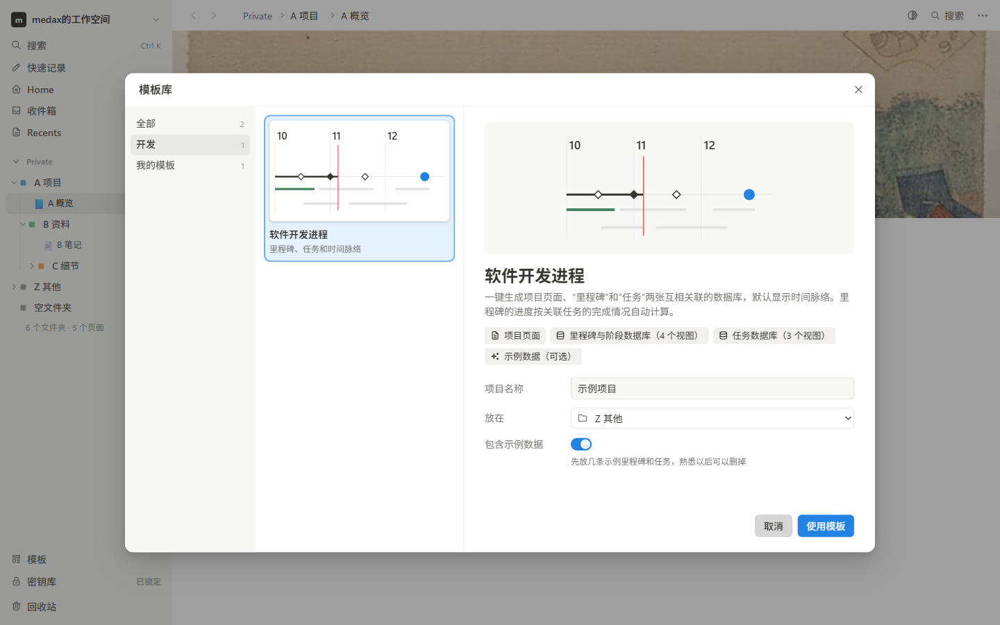

时间脉络把阶段和里程碑排列在横向时间线上。拖动条目可调整日期；用视图中的缩放或适配操作查看不同时间范围。它和表格等视图共享同一份记录，修改日期也会反映到其他视图中。

用视图的导出入口保存 **PNG 或 SVG**。导出为 **16:9** 画面，可以直接贴进 PPT；SVG 适合继续缩放，PNG 适合直接插入。

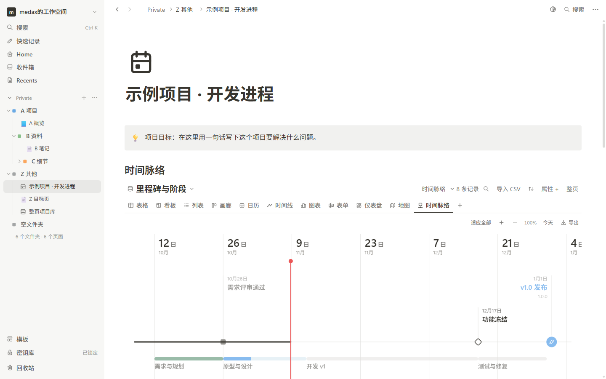

### 官方市集

侧栏「模板 → 官方市集」提供公开作品目录。浏览和下载无需注册市集账号。新安装仅带有市集入口、验签公钥和一份精简的目录。

- **专注学习页**在选定文件夹里新建一页，带本地插图、学习目标、笔记和复盘区。
- **番茄钟**插入可编辑的页面。可开始、暂停、继续、重置，并在 25 分钟专注和 5 分钟短休息之间切换。安装后可离线运行。

**从目录安装。** 选中作品可看介绍、预览和下载大小。点「下载组件」或「下载模板」时，Life Atlas 获取并验证这一个作品的完整软件包。例如，选择足迹地图时才会下载它的地图数据。下载后可试玩支持交互预览的组件，或选择页面点「插入组件」。模板可选文件夹后点「使用模板」。

**管理本机空间。** 「已下载」列出本机作品和包大小，多页使用同一版本只存一份。点「移除下载」会保留页面及个人记录。已有快照或普通附件引用同一文件时，界面会显示仍需保留的大小。再次下载同一版本、同一内容的签名包，原来的组件区块可继续使用。

**从本机文件安装。** 从公开作品目录下载 `.atlaspack`。回到桌面端的「官方市集」，点「导入本地包」，断网也可完成验签、预览和安装。下载源码的用户可以直接打开 `market/public/index.html` 浏览和下载作品。[公开作品目录](https://github.com/jamesmendax/life-atlas-public/tree/main/market/public/packages) · [投稿与审核指南](../market/CONTRIBUTING.md)

## 7. 页面与编辑器

文件夹负责整理，页面负责写内容。右键文件夹或页面可以创建、重命名、移动或移到回收站；侧栏的“+”也可快速创建页面。点击文件夹左侧箭头只展开层级，点击文件夹名称查看其中的页面。

- 在空行输入 `/`，打开斜杠菜单，选择标题、列表、待办、引用、表格、代码、公式等区块；也可以接着输入名称或别名搜索。
- 已经写好内容的区块同样可以转换：移到区块左侧，点击六点手柄，选择“转换为”；光标在正文时按 `Shift+F10` 也能打开。适用转换保留文字格式、链接、子区块和区块身份，`Ctrl+Z` 可撤销。不能无损保留内容的目标（例如带链接的文字转代码）会禁用或说明原因，不会静默删除内容。
- 分栏内也使用同一套区块菜单。拖动六点手柄可换顺序或移到另一栏，蓝色预览线表示落点；移到侧边可建立新栏。拖动栏间调整控件只改变相邻两栏，松手才保存，按 `Escape` 取消；键盘聚焦调整控件后也可以用左右方向键。
- 输入 `[[` 选择要链接的页面；空行开头的 `+` 可以新建或链接页面。
- 输入 `@` 提及人员、页面或日期；日期提及可以添加本地提醒。
- 页面右上角“页面操作”中可打开**页面历史**，对比并恢复早期版本。恢复不是删除其他所有历史；对重要修改，仍应另做完整备份。
- **反向链接**列出其他页面里指向当前页面的位置，帮助你追踪相关笔记。
- `Ctrl+F` 只在当前页面查找；`Ctrl+K` 搜索整个工作区。撤销／重做和粗体等操作见第 12 章。

普通页面中的外部图片和其他远程媒体会显示占位；需要查看时，双击占位，经确认后由外部浏览器打开。AI 助手根据请求导入的网络图片会保存为本地附件，可随页面离线查看和备份。

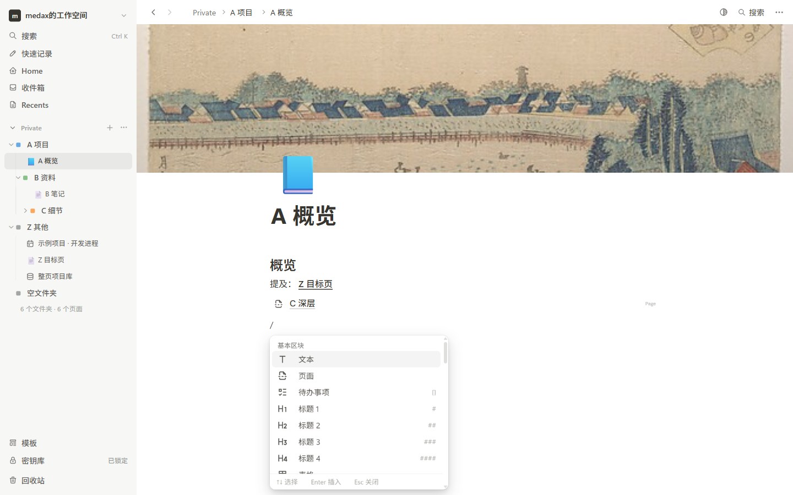

## 8. 数据库

数据库是一组记录，可以用表格、看板、列表、画廊、日历、时间轴或时间脉络等视图展示。同一数据源的不同视图共享记录，不会复制成多套数据。

### 创建与打开

- 在页面空行输入 `/`，选择“数据库 - 行内”，在当前页面加入新数据库；选择“数据库 - 整页”则新建数据库页面。
- 要在页面中使用已有数据，在斜杠菜单选择“数据源的链接视图”，再选择本地数据源。链接视图引用原有记录；在其中编辑记录也会改变同一数据源的记录。
- 点击数据库上方的数据源名称，可选择“重命名数据源”。行内数据库的“整页”会新建并打开使用同一数据源的数据库页面；整页数据库可用“转内联”将当前页面改为行内显示。
- 数据源所在页面移到回收站后，关联视图会提示来源在回收站；恢复来源后可继续使用。永久删除前请留意确认提示：所属数据库记录会随页面一并删除。

### 视图与日常操作

- 数据库顶部的标签是已保存的命名视图。点击标签切换视图；表格、看板等是可选布局，不代表每种布局都会自动有一个标签。
- 点击标签旁的“+”（添加视图），填写“视图名称”，选择“布局”，再点击“创建视图”；也可点击“取消”。名称不能为空。
- 打开“视图设置”，可修改当前视图名称，在“布局”中选择另一种布局，或设置筛选、多级排序、分组和显示属性。需要一份当前设置的副本时，点击“复制当前视图”；新视图仍使用同一数据源的记录。
- 点击“搜索此视图”查找记录；需要新记录时，点击视图底部的“新建记录”。表单布局使用表单新增记录。
- 在表格里点击单元格编辑内容；日期、状态、多选、关联等属性会使用适合它们的选择器。
- 点列标题管理属性、排序或筛选。按需要调整列宽和可见属性。
- 表格底部可选择计数、求和、平均等统计；可用项目取决于该列的属性类型。
- 点击记录标题可打开**中心预览**，在页面中央查看、编辑记录正文和属性；不是右侧详情栏。视图设置也可改为直接打开记录页面。
- 点击“导入 CSV”并选择文件，检查文件编码、表头、列对应属性和预览，再确认导入。CSV 通常只含表格内容，不等于包含页面正文与附件的完整备份。

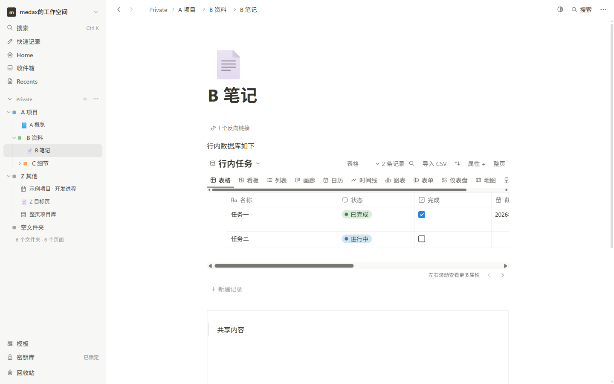

下图来自前述测试版窗口，数据库视图标签和操作面板可能与当前界面不同；请以上述操作文字和实际界面为准。它没有展示新建视图或复制视图的完整过程。

## 9. 快速记录与收件箱

在 Life Atlas 内按 `Ctrl+Shift+N` 打开快速记录；应用正在运行且快捷键注册成功时，也可在其他应用中按全局快捷键 `Ctrl+Alt+Space` 唤出它。

输入标题和正文，点击“保存”或按 `Ctrl+Enter`，内容先进入**收件箱**；“保存并打开”可以立即继续编辑。正文支持简单的 Markdown 标题、列表和待办。

在侧栏打开收件箱，定期查看未整理的记录，选择要归档的文件夹，归档后它们就进入你的正常笔记结构。本地提醒也从这里查看、处理；提醒依赖应用在本机运行，不会发送邮件、云通知或短信。

全局快捷键若被其他软件占用，可以先切回 Life Atlas，再用 `Ctrl+Shift+N`。不要为了快速记录把密码或 API Key 写进普通收件箱。

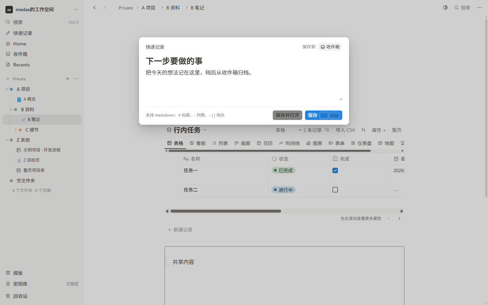

## 10. 导入 Notion、导出 Markdown

### 从 Notion 导入

1. 在 Notion 中找到要迁移的页面，使用它的“导出”功能。
2. 格式选择**“Markdown 和 CSV”**，勾选**“包含子页面”**和**“为子页面创建文件夹”**。
3. 保存导出的 ZIP 文件。在 Life Atlas 工作区菜单中选择“从 Notion 导入…”，选择这个 ZIP，查看预览后导入。
4. 导入的内容放在**新文件夹**里，不会覆盖你原来的同名页面。核对页面层级、链接、数据库记录与本地附件，并查看跳过项目或警告。

Notion 的在线能力、特殊属性和未包含在导出包中的内容不一定能还原。确认导入结果前保留原 ZIP 和原资料；Life Atlas 不会联网补下载缺失内容。

### 导出为 Markdown

在工作区菜单中选择“导出为 Markdown…”，选择要导出的范围和保存位置。结果是可读的文件夹，包含 Markdown 页面、数据库 CSV 和相应本地附件，适合**长期保存、查阅或交给其他支持 Markdown 的工具**。

Markdown 导出不是完整备份：不会用它恢复整个 Life Atlas 工作区，也不包含密钥库、回收站、页面历史和评论等完整状态。换电脑或重装时，请用 `.lifeatlas` 完整备份，而不是只带走 Markdown。

## 11. 设置与外观

工作区菜单 → “设置”，或按 `Ctrl+,` 打开设置。

在「AI 助手」中填写基础网址、模型名称和 API 密钥，然后保存。本机免密服务可以留空密钥。点击「测试连接」会发送一条简短的测试消息。需要助手编辑页面、数据库或设置时，选择支持工具调用的 Chat Completions 兼容模型。

点击工作区右下角的悬浮球，或按 `Ctrl+J` 打开对话。使用「固定在右侧」可边读边聊。可以试着说「在当前页面创建一个复习看板，再添加第一条记录」。对话中会显示已执行的步骤。DeepSeek 等服务返回思考正文时，可以展开「思考过程」，生成期间会随返回内容更新。模型连接信息由本机保存，API 密钥由 Windows 加密。发送对话时，模型服务会收到本轮所需的页面文字和工具结果。

默认的「工作区与联网」可以按你的指令查找和编辑页面、文件夹、数据库，或修改普通设置。只想聊天或找公开资料时，可以切换到「仅聊天与联网」。需要图片时也可请助手搜图，并说明要加到哪个页面。密钥库由独立窗口和主密码保护。可以附加文件和图片，识别文字、图片理解和工具调用取决于所用模型及文件类型。

多步骤任务在连续没有新进展时会暂停，对话可显示「继续未完成任务」。点击它，或在原对话发送「继续本次任务」，助手会沿用原任务和目标页面，也会参考哪些更改已经写入。对话记录和已保存的思考正文保存在本机，并随新版完整备份迁移。编辑已有消息会创建一个编辑版，保留原对话。

右键悬浮球，选择「识图取字」。框选屏幕、打开一张图片或读取剪贴板图片后，可在本机识别简体中文和英文。在窗口中按 `Ctrl+V` 可识别剪贴板图片。可直接改正识别结果，再点「复制文字」。

- 界面风格为**墨白**。模式可选**跟随系统、白天、夜间**；也可使用顶栏“切换白天／夜间”按钮。
- 可以设置新页面默认字体和启动时打开的位置；单个页面的字体与宽度仍可在页面操作中单独调整。
- 在“数据”分区查看或打开数据目录。“更换数据目录…”会把数据安全复制到新位置并重新打开，**旧目录会保留**；核对新位置和备份之前，不要手工删除旧目录。
- “查找未使用的附件”只列出不再被内容引用的候选文件。确认后移到附件回收站，**30 天内可以恢复**；不要把附件回收站当作长期备份。
- “备份”分区可以查看最近备份和计划，再进入“备份与恢复…”。密钥库设置在独立的密钥库窗口中处理。

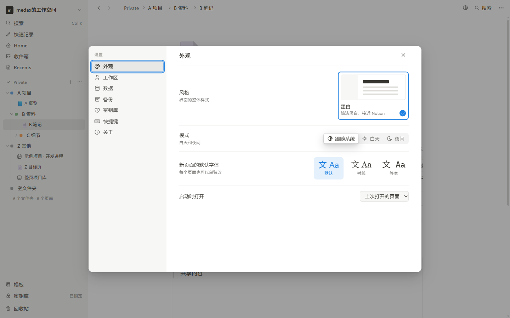

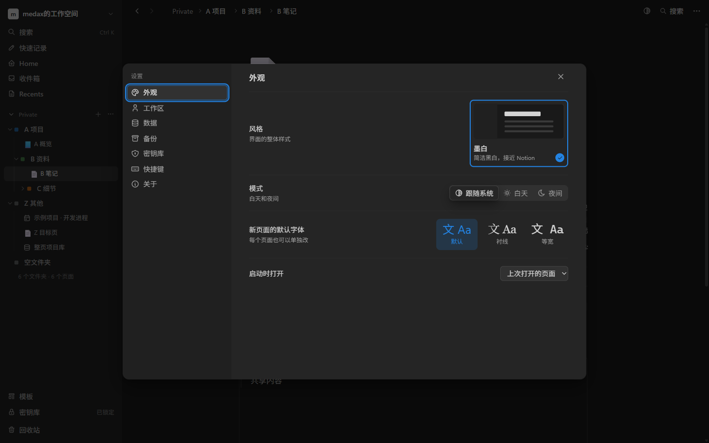

## 12. 快捷键

下表与当前应用的快捷键面板一致，共 30 项。编辑类快捷键在页面编辑器中使用。区块转换快捷键作用于当前区块或完整选区。

| 分组 | 快捷键 | 功能 | 行为 |
| --- | --- | --- | --- |
| 导航 | `Ctrl+K` | 搜索 | 按下后出现搜索对话框 |
| 导航 | `Ctrl+T` | 打开页面标签 | 打开页面搜索，选择页面后显示标签 |
| 导航 | `Ctrl+Tab / Ctrl+Shift+Tab` | 切换页面标签 | 切换到相邻的已打开页面 |
| 导航 | `Ctrl+W` | 关闭当前页面标签 | 关闭当前标签，关闭最后一个标签时回到首页 |
| 导航 | `Ctrl+,` | 打开设置 | 按下后出现设置对话框 |
| 导航 | `Ctrl+J` | 打开 AI 助手 | 打开与当前页面关联的对话输入框 |
| 导航 | `Ctrl+Shift+N` | 快速记录 | 按下后出现快速记录框 |
| 导航 | `Alt+←` | 后退 | 依次打开两个页面后按下，回到第一个页面 |
| 导航 | `Alt+→` | 前进 | 后退之后按下，回到第二个页面 |
| 导航 | `Ctrl+\` | 折叠或展开侧栏 | 按下后侧栏折叠，再按一次展开 |
| 导航 | `Ctrl+/` | 快捷键面板 | 按下后出现快捷键面板 |
| 页面 | `Ctrl+F` | 页内查找 | 按下后出现查找条 |
| 编辑 | `Ctrl+Z` | 撤销 | 输入文字后按下，文字消失 |
| 编辑 | `Ctrl+Shift+Z` | 重做 | 撤销之后按下，文字恢复 |
| 编辑 | `Ctrl+B` | 粗体 | 选中文字后按下，文字变为粗体 |
| 编辑 | `Ctrl+I` | 斜体 | 选中文字后按下，文字变为斜体 |
| 编辑 | `Ctrl+U` | 下划线 | 选中文字后按下，文字带下划线 |
| 编辑 | `Ctrl+D` | 复制当前区块 | 按下后当前区块下方出现一份副本 |
| 编辑 | `Shift+F10` | 打开当前区块菜单 | 光标在区块中时出现包含“转换为”的菜单 |
| 编辑 | `Ctrl+Alt+0` | 转换为文本 | 保留内容与子块，当前区块变为文本 |
| 编辑 | `Ctrl+Alt+1/2/3` | 转换为标题 1/2/3 | 当前已有内容变为对应层级标题，可一次撤销 |
| 编辑 | `Ctrl+Alt+4` | 转换为待办列表 | 保留内容，出现复选框 |
| 编辑 | `Ctrl+Alt+5/6/7` | 转换为项目/编号/折叠列表 | 原内容与子块仍在，列表类型变更 |
| 编辑 | `Ctrl+Alt+8` | 转换为代码 | 纯文本转换为代码；无法保留的格式会明确提示 |
| 编辑 | `Ctrl+Alt+9` | 转换为引用 | 当前已有内容变为引用，可一次撤销 |
| 插入 | `/` | 斜杠菜单 | 在空行输入后出现斜杠菜单 |
| 插入 | `@` | 提及人员、页面或日期 | 输入后出现提及菜单 |
| 插入 | `[[` | 链接页面 | 输入后出现页面菜单 |
| 插入 | `+` | 在空行开头新建或链接页面 | 在空行开头输入后出现页面菜单 |
| 插入 | `:` | 表情（再输入至少两个字母） | 输入 :sm 后出现表情网格 |

全局快速记录快捷键 `Ctrl+Alt+Space` 的使用条件和冲突处理见第 9 章。

## 13. 常见问题

### 数据目录在哪里？

打开“设置 → 数据”，可以查看当前位置并点击“打开数据目录”。程序安装目录不是数据目录。

### 卸载会删除我的内容吗？

不会。卸载只删除程序，页面、附件、密钥库和快照所在的数据目录保留。重新安装时选择同一个数据目录即可继续使用。卸载、升级或搬家前仍建议导出一份完整备份，存到另一块硬盘或 U 盘。

### 出现“数据无法读取”怎么办？

先停止编辑，不要手工删除或覆盖原数据目录。保留原目录的副本，再通过恢复界面或“备份与恢复…”选择可用的本机快照／完整备份；先核对内容和时间再恢复。如果硬盘已经故障，本机快照可能也不可用，需要另一块硬盘或 U 盘上的备份。

### 我可以离线使用吗？AI 会把哪些内容发给模型？

日常编辑和离线识图可在断网时使用。如果连接本机模型服务，AI 也可以在断网时对话。使用云端模型时会访问填写的基础网址；搜索网页、查找图片或使用云端模型时，应用需要联网，并将相关搜索词或消息发送到所选服务。涉及密钥库安全设置的更改，需要在独立密钥库窗口验证主密码。跨电脑迁移请使用完整备份。

### 全局快捷键没有反应怎么办？

先确认 Life Atlas 正在运行。若 `Ctrl+Alt+Space` 被别的软件占用，切回 Life Atlas 使用 `Ctrl+Shift+N`，或调整冲突软件的快捷键后重新打开 Life Atlas。不要依赖全局快捷键作为唯一的记录入口。

### 安装时 Windows 提示发布者未知怎么办？

当前安装包没有代码签名，Windows 可能提示来源。只使用已确认来源、大小和校验信息的安装包；不要因此关闭系统安全防护，也不要运行来历不明的同名程序。

### 忘了备份密码，能用密钥库主密码打开吗？

不能。整包备份密码和密钥库主密码互不替代。忘了备份密码，需寻找另一份能打开的备份；主密码与恢复密钥都丢失，也无法解开原密钥库。
